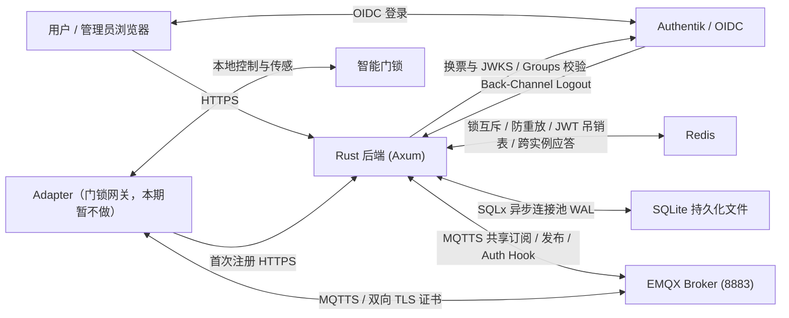
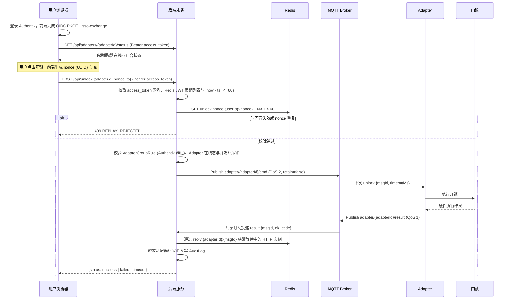

# 智能门锁后端设计文档

| 项目 | 内容 |
| --- | --- |
| 状态 | 定稿 v1.2（Rust + Podman + MQTTS） |
| 日期 | 2026-11-22 |
| 依据 | [draft.md](../draft.md) |
| 范围 | Rust 后端、Podman Compose 编排（EMQX + Redis + 异步 SQLite）、Authentik 群组授权与 Back-Channel Logout、MQTTS 双向证书、管理接口与审计（Adapter 固件端本期不做） |

> 技术栈已定案：后端采用 **Rust（Axum + Tokio + SQLx 异步 SQLite + Redis + rumqttc）**，容器编排采用 **Podman / `podman-compose`**，MQTT Broker 采用 **EMQX**（启用 MQTTS 证书）。

---

## 0. 简明版设计总览（1 分钟速览）

> **一句话架构**：用户经 **Authentik（OIDC）** 登录后向后端发起开锁（`nonce + ts` 防重放），门锁权限由 **Authentik 群组（Groups）** 规则决定；Rust 后端与 **EMQX（MQTTS 双向证书）**、**Redis**、**异步 SQLite** 经 `podman-compose` 协同运行，并支持 Authentik Back-Channel Logout 与三粒度 JWT 吊销列表即时吊销会话。

### 四条核心链路

1. **用户开锁**：进入门禁控制台 → 完成 Authentik 登录并用 `POST /api/auth/sso-exchange` 换取双 Token（同步拉取 `groups`）→ 点击开锁时前端生成随机 `nonce`（UUID）与 `ts` 调用 `POST /api/unlock`（时间窗校验 + Redis `SET NX` 判重防重放），校验门锁适配器所属 **Authentik 群组规则**与并发互斥后下发 MQTT `unlock`（`QoS 2, retain=false`）→ 10s 内等待硬件 `result` 并落审计（默认保留 90 天可调）。
2. **用户认证、多端并发与 JWT 吊销**：15 分钟无状态 `accessToken`（JWT，配合 Redis **JWT 吊销列表**即时失效）+ 7 天 `refreshToken`（`httpOnly` Cookie，刷新即轮换）。单用户默认最多同时在线 **3 台设备**，超限时按 `last_active_at` 淘汰最久未访问设备（LRU），被踢端下次请求立即返回 `DEVICE_KICKED`；Authentik 侧触发登出/吊销时通过 `POST /api/auth/backchannel-logout` 写入吊销列表，本地会话即时失效。
3. **Adapter 接入与保活（TOFU + MQTTS 证书）**：设备首次自生成高熵 `adapter_token` 调 `POST /api/adapter/register` 进入 `pending` → 管理员核对硬件指纹审批（已审批/吊销禁止重注册覆盖）→ 设备携带 **MQTTS 证书**与 `clientId=username=adapterId`、`password=adapter_token` 直连 `mqtts://{host}:8883`（`cleanStart=true, keepAlive=30s` + LWT 遗嘱感知上下线），EMQX 通过内部 Auth/ACL Hook 严格隔离单设备 Topic → 在线按 `tokenRefreshInterval` 平滑轮换凭据。
4. **门锁状态回传**：变化立即上报 + 重连发 `snapshot=true` + 60s 周期兜底。开锁指令回执**不改写**开合状态；Adapter 离线超 5 分钟对外展示 `unknown`（保留最后上报时间），在线超 2 个周期无更新标 `stale=true`。

### 核心入口速查

| 端 | 关键入口 / Topic | 用途 |
| --- | --- | --- |
| **用户 / SSO HTTP** | `POST /api/auth/sso-exchange` / `refresh` / `logout` / `backchannel-logout` | Authentik 换票、续签、注销与 Back-Channel 吊销 |
| **用户 HTTP** | `GET /api/adapters/{id}/status`、`POST /api/unlock` | 查门锁适配器状态、一步防重放校验并执行开锁 |
| **设备引导 HTTP** | `POST /api/adapter/register`、`GET /api/adapter/status` | 首次注册凭据、轮询审批状态 |
| **设备 MQTTS** | 下行 `adapter/{id}/cmd`；上行 `ack` / `result` / `state` / `presence` | 下发指令、回执、状态与上下线 |
| **管理端 HTTP** | `/api/admin/adapters/*`、`/locks/*`、`/users/*`、`/audit-logs`、`/config` | 审批/吊销、绑锁、配置群组权限、审计、系统配置（无需 TOTP） |

---

## 1. 系统概览与边界

### 1.1 核心架构



核心能力：
1. **用户开锁**：用户打开前端门锁控制页，经 SSO 认证、防重放校验与服务端权限校验后，向目标 `Adapter` 下发开锁指令。
2. **Adapter 接入与指令通信**：门锁网关（Adapter）通过 MQTTS 与 MQTT Broker 保持长连接，接收 `unlock` / `query_state` / `refresh_token` 指令并回传执行结果。
3. **门锁状态回传**：Adapter 上报门锁实时开合状态，后端结合离线时长给出状态可信度标记。
4. **多端登录控制**：支持用户多设备在线，超出并发上限时自动踢出最久未访问（`last_active_at` 最早）的设备。
5. **管理与审计**：管理员在面板审批 Adapter、绑定门锁、配置授权与系统参数、查看状态与不可篡改审计日志。

### 1.2 信任边界与非目标

- **信任边界**：
  - 后端不信任前端传入的 `adapterId` 权限，每次开锁与状态查询均须校验用户所属 Authentik 群组是否命中该适配器的 `AdapterGroupRule`（`admin` 除外）。
  - 后端不信任 Adapter 自报的业务归属，设备接入以管理员首次审批绑定（TOFU）+ **MQTTS 证书校验**为准；EMQX 通过内部 Auth/ACL Hook 严格隔离各设备的订阅/发布 Topic，防止越权伪造或窃听。
  - `unlock` 指令成功回执仅代表动作已执行，**不直接改写门锁开合状态**，开合状态以设备传感器上报为准。
- **本期非目标**：Adapter 硬件/固件端实现（本期先不做，后端提供完整 MQTT 协议对接与集成测试）、固件 OTA 与签名校验、离线密码、临时访客码、管理端 TOTP 二次验证。

---

## 2. 领域模型与状态约定

| 实体 | 职责 | 关键字段与约束 | 状态流转 |
| --- | --- | --- | --- |
| **User** | 系统用户 | `id`, `sso_subject` (唯一), `display_name`, `groups_json` (同步自 Authentik `groups`), `role` (`user`/`admin`), `status` (`active`/`disabled`), `last_login_at` | `active` ↔ `disabled` |
| **UserDevice** | 用户登录终端会话 | `id` (写入 access token), `user_id`, `device_id` (前端持久化), `device_name`, `sso_sid` (可空，Authentik OIDC `sid`), `refresh_token_hash`, `last_ip`, `created_at`, `last_active_at` | `online` → `kicked` / `logged_out` / `expired`；同一 `(user_id, device_id)` 仅保留一条 `online`，重复登录复用并刷新 `last_active_at` |
| **AdapterGroupRule** | 适配器-Authentik 群组授权规则 | `(adapter_id, authentik_group)` 唯一索引, `created_by`, `created_at` | 规则增删即时生效（比对 `User.groups_json`） |
| **Adapter** | 门锁统一抽象实体（兼硬件设备与门禁实体） | `id` (设备标识), `name` (展示名称), `reported_state` (`locked`/`unlocked`/`unknown`), `state_reported_at`, `model`, `fw_version`, `token_hash`, `pending_token_hash`, `token_refresh_interval` (默认 43200s), `last_seen_at`, `approved_by`, `approved_at` | **审批态**、**在线态**与**门合状态**解耦：<br>• `approval_status`: `pending` → `approved` / `rejected`；`approved` → `revoked`<br>• `online_status`: `online` ↔ `offline`（由 MQTT 上下线事件与 LWT 驱动）<br>• `reported_state`: 由设备上报驱动（见 4.3） |
| **AuditLog** | 不可变审计记录 | `id`, `actor_type` (`user`/`admin`/`adapter`/`system`), `actor_id`, `action`, `target_type`, `target_id`, `result` (`success`/`failed`/`timeout`/`denied`), `detail` (json), `ip`, `request_id`, `created_at` | **只追加**，无修改/删除接口；按 `auditRetentionDays`（默认 90 天）由后台任务定期清理过期记录 |

---

## 3. 认证与安全模型

### 3.1 Token 体系

| Token 类型 | 使用方 | 传输载体 | 有效期 | 服务端存储与失效方式 |
| --- | --- | --- | --- | --- |
| `user_access_token` | 用户 / 管理面板 | `Authorization: Bearer` | 15 分钟 | 无状态 JWT（含 `jti` / `deviceSessionId`）+ Redis 吊销列表（TTL ≤ 15 分钟） |
| `user_refresh_token` | 用户 / 管理面板 | `httpOnly; Secure; SameSite=Lax` Cookie | 7 天 | 数据库/Redis 存 hash；每次刷新轮换，重放即吊销全家族 |
| `adapter_token` | Adapter 网关 | 注册与状态查询走 HTTPS；长连作为 MQTT `password` | 长期有效，在线定期轮换 | 存 hash（含轮换过渡期 `pending_token_hash`）；吊销即失效并踢下线 |

> 用户侧与设备侧 token 使用独立签名密钥与校验链路，严禁混用。

### 3.2 用户认证、多端并发与 Authentik 吊销联动

1. **Authentik OIDC 换票与群组同步**：前端完成 Authentik OIDC（Authorization Code + PKCE）登录后，携带授权码 `code`（与 `codeVerifier`、`redirectUri`）以及本地持久化 `deviceId`、`deviceName` 调用 `POST /api/auth/sso-exchange`。后端向 Authentik Token Endpoint 换取并校验 `id_token`（通过 Authentik JWKS 验签并校验 `iss`/`aud`/`exp`），提取 `sub`（`User.sso_subject`）、`sid`（`UserDevice.sso_sid`）及 `groups`（如 `id_token` 未携带则同步请求 Authentik `userinfo`），更新 `User.groups_json` 并按系统配置的 `admin_groups` 同步映射 `role`（`admin` / `user`），签发后端双 token 并登记 `UserDevice`。
   - **群组授权校验**：用户查状态与开锁时，后端检查 `User.groups_json` 与适配器 `AdapterGroupRule` 是否有交集（`admin` 默认具备全部门锁权限）。续签（`POST /api/auth/refresh`）时可按需向 Authentik `userinfo` 同步最新群组与账号启用状态，避免成员被移出群组后仍保留旧权限。
2. **并发上限与淘汰（LRU）**：在用户级互斥锁内统计 `online` 状态的 `UserDevice` 数量（默认上限 `maxDevicesPerUser = 3`，后台可配）：
   - 同一 `(user_id, device_id)` 重复登录：复用原记录、轮换 refresh token 并刷新 `last_active_at`，不新增名额。
   - 超出上限（含管理员调小上限时）：按 `last_active_at` 淘汰最久未访问（最早活跃）的设备，将其置为 `kicked`、吊销其 refresh token，并写入 Redis JWT 吊销列表立即失效。
   - `last_active_at` 在登录、续签及持 `user_access_token` 访问受保护接口时更新（高频请求可先更新 Redis ZSET/Hash 活跃时间并节流落库，避免每次请求写库）。
3. **JWT 吊销列表（Redis TTL 黑名单）与续签**：
   - `user_access_token` 为短效 JWT（15 分钟），载荷携带 `sub`（`user_id`）、`jti`、`deviceSessionId`（`UserDevice.id`）及 `iat`/`exp`。
   - **三粒度吊销键（均设 TTL = 15 分钟自动过期清理，体量极小）**：
     - **设备会话级** `jwt:revoked:device:{deviceSessionId}`（值为 `kicked` / `logged_out`）：用于设备被踢、主动 `logout`、按 `sid` 的 Back-Channel Logout。
     - **用户全量级** `jwt:revoked:user:{userId}`（值为 `revokedAt` 秒级时间戳）：用于全账号 Back-Channel Logout、管理员禁用用户；校验时凡 `jwt.iat <= revokedAt` 一律拒绝，无需枚举全部历史 `jti`。
     - **单 Token 级** `jwt:revoked:jti:{jti}`（TTL = `exp - now`）：用于针对单张 access token 的精确吊销。
   - **鉴权热路径**：本地验签 JWT 后通过 Redis 单次 `MGET` 同时查询上述吊销键（0 次数据库查询）：命中 `kicked` 返回 `401 DEVICE_KICKED`，其余吊销返回 `401 UNAUTHORIZED`；若 Redis 发生冷启动恢复，可从数据库加载近 15 分钟内 `kicked`/`logged_out` 的设备及 `disabled` 用户回填吊销列表。
   - 前端收到 401 且非 `DEVICE_KICKED` 时调用 `POST /api/auth/refresh` 静默续签；若返回 `DEVICE_KICKED` 或刷新失败，清空本地状态并跳转 Authentik 重新登录。
4. **OIDC Back-Channel Logout（Authentik 吊销/登出联动）**：
   - 在 Authentik Provider 配置 Back-Channel Logout URI 为 `POST https://{host}/api/auth/backchannel-logout`。当用户在 Authentik 主动登出或管理员终止其会话/吊销账号时，Authentik 直接向该接口发送 `application/x-www-form-urlencoded` 请求（参数 `logout_token=<JWT>`）。
   - **Token 校验**：通过 Authentik JWKS 验签并校验 `iss`/`aud`；校验 `events` 包含 `"http://schemas.openid.net/event/backchannel-logout"`；**严禁存在 `nonce` 字段**（符合 OIDC Back-Channel Logout 1.0 规范）；使用 Redis `SET jti 1 NX EX 900` 防止 `logout_token` 重放。
   - **精准吊销**：若 `logout_token` 含 `sid` 且本地存在对应 `(sso_subject=sub, sso_sid=sid)` 会话，则将对应 `UserDevice` 置为 `logged_out`、吊销其 `user_refresh_token` 并写入 `jwt:revoked:device:{deviceSessionId}`（TTL 15 分钟）；若不含 `sid`（或全账号吊销场景），则将该 `sub` 下的**全部** `online` `UserDevice` 置为 `logged_out`、吊销全部 `user_refresh_token` 并写入用户级吊销键 `jwt:revoked:user:{userId}`（TTL 15 分钟），同时写入 `AuditLog`（`actor_type = system`、`action = sso_backchannel_logout`）。
   - **响应与兜底**：处理成功返回 `200 OK`（响应头 `Cache-Control: no-store`），`logout_token` 非法返回 `400`。若 Authentik 后台仅停用账号而未触发登出事件，可在 `POST /api/auth/refresh` 续签时按需校验 Authentik 用户态（UserInfo / Introspection）或配合 Authentik Webhook，防止被禁用用户继续静默续签。

### 3.3 Adapter 接入、Broker 鉴权与凭据轮换（TOFU）

为避免设备侧引入复杂 PKI 证书，同时消除「仅靠公开硬件 ID 即可接入」的漏洞，Adapter 采用 **首次信任（TOFU）绑定 + Broker 鉴权与 ACL 隔离 + 在线平滑轮换**：

1. **首次注册**：Adapter 启动时若本地无有效凭据，在本地生成高熵随机 `adapter_token`（≥ 32 字节）并持久化，调用 HTTPS `POST /api/adapter/register` 提交 `{ adapterId, token, model, fwVersion }`。后端存储 `token_hash`，置 `approval_status = pending`。
   - **防抢注保护**：若该 `adapterId` 已处于 `approved` 或 `revoked`，`register` 禁止覆盖已有凭据（`token_hash` 一致时幂等返回当前状态；不一致则返回 `409 DEVICE_ALREADY_REGISTERED` 或 `403 DEVICE_REVOKED`）。
2. **等待与人工审批**：设备携带 `Bearer <adapter_token>` 退避轮询 `GET /api/adapter/status`（避免未审批期间盲目重连 MQTT 触发 Broker 认证告警）；管理员核对 `adapterId` 指纹（如 SHA-256 前 16 位）并批准（`approved`）后，设备开始发起 MQTTS 连接。若返回 `revoked` 则停止重试。
3. **MQTT 认证与 Topic ACL 隔离**：
   - Adapter 连接 MQTTS 时使用 `clientId = username = {adapterId}`、`password = {adapter_token}`。
   - MQTT Broker 通过 Auth/ACL 回调（或直连后端鉴权接口）校验：仅 `approval_status == approved` 且 `password` 匹配 `token_hash`（或过渡期 `pending_token_hash`）时放行连接。
   - **Topic 权限严格隔离**：`{adapterId}` 仅允许订阅 `adapter/{adapterId}/cmd`，仅允许发布 `adapter/{adapterId}/ack`、`result`、`state`、`presence`、`error`；禁止订阅通配符（`#` / `+`）或访问其他设备 Topic。
4. **平滑轮换（防断电失联）**：
   - 在线期间，服务端按 `token_refresh_interval`（默认 12h）生成新 token，发布至 `adapter/{adapterId}/cmd`。
   - 服务端将新 token 的 hash 暂存至 `pending_token_hash`，**过渡期内新旧凭据均可通过 Broker 认证**。
   - Adapter 将新 token 持久化后向 `adapter/{adapterId}/ack` 回复确认（或下次使用新 token 成功连上 Broker），服务端将 `token_hash` 正式替换为 `pending_token_hash` 并作废旧 token。
5. **吊销与重置**：管理员吊销（`revoked`）时，后端立即调用 Broker 管理接口强制断开该 `clientId` 会话，并拒绝后续连接；若设备闪存丢失需重绑，管理员可执行「重置绑定」后重新注册审批。

> **MQTT 证书体系（MQTTS + mTLS）**：系统提供私有根 CA（`ca.crt` / `ca.key`），分别为 **EMQX Broker 服务端**、**Rust 后端 MQTT 客户端** 及 **Adapter 设备端** 签发证书。EMQX 监听 `8883`（强制 TLS 1.2+ 并启用客户端证书校验 `verify_peer`），彻底关闭非加密 `1883` 端口暴露；即使在公网部署，链路传输与设备证书均受 CA 约束，并叠加 `adapter_token` 应用层轮换实现双重防护。

---

## 4. 核心业务流程

### 4.1 用户开锁



关键约束：
- **一步开锁与防重放**：点击开锁时由前端生成随机 `nonce`（UUID）和秒级时间戳 `ts`；后端校验 `|now - ts| <= 60s`（依赖 NTP 校时）并用 Redis `SET NX EX 60` 对 `(userId, nonce)` 原子判重，超期或重放返回 `409 REPLAY_REJECTED`。
- **权限校验**：每次开锁以用户所属 Authentik 群组是否匹配适配器 `AdapterGroupRule` 为准（`admin` 除外）；凭据统一走 `Authorization: Bearer`。
- **串行互斥与快速失败**：同一适配器同时仅允许 1 条在途开锁指令，冲突立即返回 `409 ADAPTER_BUSY`；`Adapter.online_status != online` 时立即返回 `503 ADAPTER_OFFLINE`，**绝不投递到 MQTT 队列等待**；等待 `result` 默认超时 10s。
- **防过期重放**：`cmd` 消息禁用 `retain` 且设备端以 `cleanStart = true` 建连；Adapter 收到 `unlock` 时仍须校验 `now - ts <= timeoutMs`（并配合 MQTT v5 `Message Expiry Interval`），超时指令直接丢弃，防止网络恢复后延迟开门。
- **不自动重试**：超时或失败后需用户重新点击触发（前端重新生成 `nonce` 与 `ts`）。

### 4.2 Adapter 连接保活与上下线感知

- **连接参数**：Adapter 连接 `mqtts://{host}:8883` 时设置 `cleanStart = true`、`keepAlive = 30s`（Broker 在 `1.5 × keepAlive = 45s` 未收到心跳或报文即判定断线）。断线后按指数退避重连（1s → 2s → 4s … 上限 60s，含随机抖动）。
- **上下线感知（LWT + Broker 事件）**：
  - Adapter 建连时配置遗嘱消息（LWT）：Topic 为 `adapter/{adapterId}/presence`，`retain = true`、`QoS = 1`，内容 `{ "online": false }`。
  - 连接成功后立即发布上线消息至同一 Topic：`{ "online": true, "fwVersion": "...", "ts": ... }`（`retain = true`、`QoS = 1`）。
  - 后端同时接入 Broker 的 `client.connected` / `client.disconnected` 事件通知（Webhook 或系统主题）与 `presence` 订阅，确保无论正常断开还是异常掉线都能即时更新 `online_status` 与 `last_seen_at`。

### 4.3 门锁状态回传与可信度

Adapter 向 `adapter/{adapterId}/state` 上报门锁状态的四种时机（`QoS = 1`, `retain = false`）：
1. **事件触发**：传感器检测到门锁开合变化时立即上报。
2. **重连纠偏**：每次 MQTT 重连并订阅 `cmd` 成功后，立即发送携带 `snapshot: true` 的 `state` 消息，弥补断连期间遗漏。
3. **主动查询**：管理面板触发刷新时，后端下发 `query_state`，Adapter 立即读取并上报。
4. **周期兜底**：在线期间每 60s（可配）上报一次当前状态。

状态处理与可信度计算：
- **归属解析**：由 Topic 中的 `adapterId` 直接定位数据库中的 `Adapter` 实体并更新其 `reported_state` 与 `state_reported_at`。
- **按需审计**：仅当 `reported_state` 发生实质变化时写入 `AuditLog`（`action = lock_state_change`）；相同状态的周期上报只刷新 `state_reported_at`。
- **展示态与事实分离**：数据库持久化设备最后一次上报的 `reported_state` 与 `state_reported_at`；查询接口实时计算最终状态：
  - 若关联 Adapter `online_status == offline` 且距 `last_seen_at` 超过 **5 分钟**（可配）：对外返回 `state = "unknown"`，同时保留 `stateReportedAt` 供前端展示「最后更新于」。
  - 若 Adapter 在线但距 `state_reported_at` 超过 **2 个上报周期（120s）**：返回 `stale: true`，前端提示「状态可能过期」。

---

## 5. 接口与协议规范

### 5.1 HTTP 通用约定

- **传输与编码**：全站强制 HTTPS，默认 UTF-8 JSON（`POST /api/auth/backchannel-logout` 依 OIDC 规范接收 `application/x-www-form-urlencoded`），时间戳统一 Unix 秒。
- **方法约定**：仅使用 `GET`（只读查询）和 `POST`（创建、修改、删除及控制指令），不使用 `PUT` / `PATCH` / `DELETE` 等其他 HTTP 方法。
- **统一响应结构**：
  ```json
  { "code": "OK", "message": "success", "data": {}, "requestId": "req_01J..." }
  ```
- **鉴权**：除 `/unlock` 页面路由、`sso-exchange`、`refresh`、`backchannel-logout`（校验 `logout_token` JWT）及 `adapter/register` 外，均通过 `Authorization: Bearer <token>` 鉴权。

### 5.2 HTTP 接口清单

#### 用户侧

| 方法与路径 | 鉴权 | 说明 |
| --- | --- | --- |
| `POST /api/auth/sso-exchange` | Authentik 授权码 | 校验 Authentik OIDC 授权码与 `id_token`，登记 `UserDevice`（含 `sso_sid`），签发双 token |
| `POST /api/auth/refresh` | refresh Cookie | 轮换 refresh token 并签发新 `accessToken` |
| `POST /api/auth/logout` | `user_access_token` | 标记当前 `UserDevice` 为 `logged_out` 并吊销 refresh token |
| `POST /api/auth/backchannel-logout` | `logout_token` JWT | 接收 Authentik Back-Channel Logout 回调，按 `sid`/`sub` 吊销本地会话 |
| `GET /api/me` | `user_access_token` | 获取当前用户信息及已授权的门锁适配器列表 |
| `GET /api/adapters/{id}/status` | `user_access_token` | 查询门锁适配器最新状态（需授权）：`{ adapterId, name, state, stateReportedAt, online, stale }` |
| `POST /api/unlock` | `user_access_token` | 执行开锁：`{ adapterId, nonce, ts }` → `{ status: "success" \| "failed" \| "timeout" }` |

#### 设备侧（Adapter HTTP 引导接口）

| 方法与路径 | 鉴权 | 说明 |
| --- | --- | --- |
| `POST /api/adapter/register` | 无（按 `adapterId` + IP 限流） | 提交 `{ adapterId, token, model, fwVersion }` 注册并进入 `pending`；已批准/吊销设备禁止覆盖 |
| `GET /api/adapter/status` | `Bearer <adapter_token>` | 审批等待期查询状态：`{ adapterId, approvalStatus, mqttEndpoint, stateReportPeriodSec }` |

#### 管理端（均需 `admin` 角色，写操作全部落审计）

| 方法与路径 | 说明 |
| --- | --- |
| `GET /api/admin/adapters` | Adapter 列表（含实时在线、开合状态、授权群组与 `adapterId` 指纹；支持按状态筛选） |
| `POST /api/admin/adapters/{id}/approve` / `reject` | 审批通过 / 拒绝待审批设备 |
| `POST /api/admin/adapters/{id}/revoke` | 吊销设备，调用 Broker API 强制踢下线并拉黑凭据（前端二次确认 + 必填原因，无需 TOTP） |
| `POST /api/admin/adapters/{id}/reset` | 重置设备与授权群组规则，允许原 `adapterId` 重新注册（前端二次确认 + 必填原因，无需 TOTP） |
| `POST /api/admin/adapters/{id}/refresh-token` | 主动下发 MQTT `refresh_token` 指令触发轮换 |
| `POST /api/admin/adapters/{id}/update` | 修改适配器展示名称（`name`）与密钥轮换周期（`tokenRefreshInterval`） |
| `GET /api/admin/adapters/{id}/groups`、`POST /api/admin/adapters/{id}/groups` | 查询 / 设置适配器允许开锁的 Authentik 群组列表（`AdapterGroupRule`） |
| `POST /api/admin/adapters/{id}/unlock` | 管理员紧急开锁（跳过群组规则，前端二次确认并填写原因，无需 TOTP） |
| `POST /api/admin/adapters/{id}/refresh-state` | 下发 `query_state`，强制刷新门锁适配器状态 |
| `GET /api/admin/users`、`POST /api/admin/users/{id}/kick` | 用户列表查询 / 强制踢出用户全部在线会话（用户角色与启停状态由 Authentik 单一事实源经 OIDC/Webhook/Core API 同步，不提供本地修改接口） |
| `GET /api/admin/audit-logs` | 审计日志查询（支持时间、操作人、门锁、结果筛选与导出） |
| `GET /api/admin/config`、`POST /api/admin/config` | 查询 / 更新系统配置（`unlockReplayWindowSec`、`commandTimeoutMs`、`maxDevicesPerUser`、`auditRetentionDays`（默认 90 天）、`stateReportPeriodSec`（保存后推送至在线设备）、`adminGroups` 等；调小并发上限立即踢出超限设备） |

#### 内部 Broker 回调接口（独立内网监听端口 `INTERNAL_HTTP_ADDR`，默认 `8081`，不对宿主机映射，使用 `INTERNAL_MQTT_SECRET` 鉴权）

| 方法与路径 | 说明 |
| --- | --- |
| `POST /internal/mqtt/auth` | EMQX 连接鉴权回调：校验 `adapter_token` 与 `approval_status == approved` |
| `POST /internal/mqtt/acl` | EMQX Topic 权限校验：仅允许 `{adapterId}` 订阅自身 `cmd` 并发布自身上行 Topic |
| `POST /internal/mqtt/events` | 接收 EMQX 客户端上下线事件，实时更新 `Adapter.online_status` 与 `last_seen_at` |

### 5.3 MQTT 通信协议

- **接入参数**：`mqtts://{host}:8883`（TLS 1.2+），`clientId = username = {adapterId}`，`password = {adapter_token}`，`cleanStart = true`，`keepAlive = 30s`。
- **后端订阅**：采用共享订阅（如 `$share/backend/adapter/+/ack`、`+/result`、`+/state`、`+/presence`、`+/error`），保证多实例水平扩展时不重复消费。
- **消息信封**（`ack` / `result` / `cmd` 均携带 `msgId` 精确关联，杜绝超时回执串台；心跳由 MQTT 协议层 `PINGREQ`/`PINGRESP` 承担，不再定义业务 `ping`/`pong`）：

```json
{
  "v": 1,
  "msgId": "msg_01J...",
  "ts": 1763164740,
  "payload": {}
}
```

| Topic | 方向 | QoS / Retain | `payload` 示例与语义 |
| --- | --- | --- | --- |
| `adapter/{adapterId}/cmd` | 后端 → 设备 | QoS 2 / `retain=false` | `unlock`: `{ "command": "unlock", "timeoutMs": 10000 }`（严禁 retain；设备侧亦须以 QoS 2 订阅并校验超时丢弃） |
| `adapter/{adapterId}/cmd` | 后端 → 设备 | QoS 1 / `retain=false` | `query_state`: `{ "command": "query_state" }` |
| `adapter/{adapterId}/cmd` | 后端 → 设备 | QoS 1 / `retain=false` | `refresh_token`: `{ "command": "refresh_token", "token": "..." }` |
| `adapter/{adapterId}/cmd` | 后端 → 设备 | QoS 1 / `retain=false` | `set_config`: `{ "command": "set_config", "stateReportPeriodSec": 60 }`（上线及配置变更时下发状态上报周期） |
| `adapter/{adapterId}/ack` | 设备 → 后端 | QoS 1 / `retain=false` | `{ "command": "refresh_token" \| "set_config" }`（表示指令接收或新配置/新 token 已落盘；`unlock` 不以 `ack` 判成功） |
| `adapter/{adapterId}/result` | 设备 → 后端 | QoS 1 / `retain=false` | `{ "ok": true, "code": "OK", "message": "" }`（`unlock` 最终执行回执，按 `msgId` 匹配） |
| `adapter/{adapterId}/state` | 设备 → 后端 | QoS 1 / `retain=false` | `{ "state": "locked", "snapshot": false }`（设备主动上报，重连发 `snapshot=true`） |
| `adapter/{adapterId}/presence` | 设备/LWT → Broker | QoS 1 / `retain=true` | `{ "online": true }` / 遗嘱 `{ "online": false }` |
| `adapter/{adapterId}/error` | 设备 → 后端 | QoS 0 / `retain=false` | `{ "code": "...", "message": "..." }`（设备协议/解码异常上报） |

并发规则：`unlock` 按门锁在服务端串行互斥；`refresh_token` 与 `query_state` 可独立下发，通过 `msgId` 各自归属，不阻塞正常开锁。

### 5.4 错误码定义

| 错误码 | HTTP | 含义 |
| --- | --- | --- |
| `OK` | 200 | 成功 |
| `INVALID_ARGUMENT` | 400 | 参数缺失或格式非法 |
| `UNAUTHORIZED` | 401 | 未登录或 access/refresh token 无效 |
| `DEVICE_KICKED` | 401 | 当前终端已被踢下线，需重新登录 |
| `FORBIDDEN` | 403 | 角色权限不足 |
| `ADAPTER_FORBIDDEN` | 403 | 无该门锁适配器开锁或查询授权 |
| `DEVICE_PENDING` | 403 | Adapter 尚未获管理员批准 |
| `DEVICE_REVOKED` | 403 | Adapter 已被吊销 |
| `ADAPTER_NOT_FOUND` | 404 | 门锁适配器不存在 |
| `ADAPTER_BUSY` | 409 | 该门锁适配器有在途开锁指令 |
| `DEVICE_ALREADY_REGISTERED` | 409 | Adapter 已绑定其他凭据，禁止覆盖 |
| `REPLAY_REJECTED` | 409 | 请求时间戳超出允许窗口或 `nonce` 重复 |
| `RATE_LIMITED` | 429 | 触发限流 |
| `INTERNAL` | 500 | 服务端内部错误 |
| `DEVICE_ERROR` | 502 | 设备执行开锁失败 |
| `ADAPTER_OFFLINE` | 503 | Adapter 不在线 |
| `DEVICE_TIMEOUT` | 504 | 等待设备执行回执超时 |

---

## 6. 工程与安全约束

### 6.1 多实例协同与跨实例唤醒

采用 MQTT Broker 后，后端无需维护设备长连路由表，水平扩展仅需保证：
- **下行指令**：任意 HTTP 实例可直接向 Broker 的 `adapter/{adapterId}/cmd` 发布指令。
- **上行同步应答**：后端集群通过 MQTT 共享订阅消费 `adapter/+/result`，收到结果后通过 Redis Pub/Sub 向 `reply:{msgId}` 广播，唤醒正在等待 HTTP 响应的那个实例（10s 超时自动清理）。

### 6.2 限流策略

| 入口 | 限流维度与阈值（默认） |
| --- | --- |
| `POST /api/auth/sso-exchange` | 10 次/分钟/IP |
| `POST /api/auth/backchannel-logout` | 仅放行 Authentik 来源 IP 或设高阈值（避免批量吊销误限流） |
| `POST /api/unlock` | 5 次/分钟/用户，20 次/分钟/IP |
| `POST /api/adapter/register` | 3 次/小时/adapterId，10 次/分钟/IP |
| `GET /api/adapter/status` | 12 次/分钟/adapterId |
| MQTT Broker `CONNECT` | 单 `adapterId` 限频（如 10 次/分钟，防重连风暴） |

### 6.3 关键非功能与安全基线

- **性能目标**：设备在线时开锁端到端 P95 ≤ 3s（指令超时默认 10s）；状态上报到接口可见 P95 ≤ 2s。
- **凭据与日志脱敏**：数据库仅存 token hash；应用日志、MQTT 报文日志与审计日志严禁输出 `Authorization` 头、Cookie、MQTT `password` 及 token 原文。
- **审计可靠性与保留期**：审计写入与开锁主链路解耦（异步落库），确保审计故障不阻断紧急开锁，同时不丢失记录；后台定时清理任务按 `auditRetentionDays`（默认 **90 天 / 3 个月**，支持管理员动态调整）清理过期审计日志。
- **时钟同步**：服务端、MQTT Broker 与 Adapter 均需启用 NTP 校时，保证指令超时判定与 JWT 校验准确。
- **可观测性**：全链路透传 `requestId` / `msgId`；核心监控覆盖开锁成功率与耗时、在线 Adapter 数、指令超时数、MQTT Broker 鉴权失败突增告警。

### 6.4 容器化部署与异步 SQLite 约束

- **Podman 编排（`podman-compose`）**：统一拉起 `broker`（EMQX，监听 `8883` MQTTS 证书端口）、`redis`（Redis 7）与 `backend`（Rust 服务容器，挂载 SQLite 持久化卷 `/data` 与 TLS 证书卷 `/certs`）。
- **异步 SQLite 兼容层**：Rust 后端通过 **SQLx（Tokio 异步运行时）** 管理 SQLite 连接池，初始化启用 `PRAGMA journal_mode = WAL`、`PRAGMA synchronous = NORMAL`、`PRAGMA foreign_keys = ON` 与 `busy_timeout = 5000`，兼顾异步非阻塞 I/O 与高并发读写可靠性。

---

## 7. 架构决策定案

1. **技术栈与容器化**：后端采用 **Rust（Axum + Tokio + SQLx 异步 SQLite + Redis + rumqttc）**，通过 **Podman / `podman-compose`** 编排 `broker`（EMQX，支持 QoS 2）、`redis` 与 `backend`；Adapter 固件端本期暂不实现。
2. **门锁授权来源**：采用 **Authentik 群组（Groups）规则**（`AdapterGroupRule`），不再人工维护逐人授权记录。
3. **MQTT 证书**：启用 **MQTTS（TLS 1.2+ / mTLS）证书**，提供私有 CA 与证书签发脚本，挂载至 Broker 与后端客户端。
4. **管理端二次验证**：紧急开锁、设备吊销、重置绑定采用「前端二次确认 + 原因必填 + 强制审计」，**不接入 TOTP**。
5. **审计日志保留期限**：默认 **90 天（3 个月）**，支持在管理端 `config` 中动态调整 `auditRetentionDays`。
